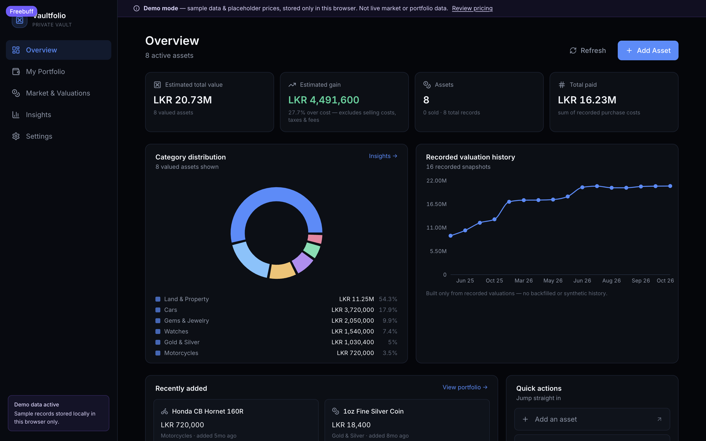
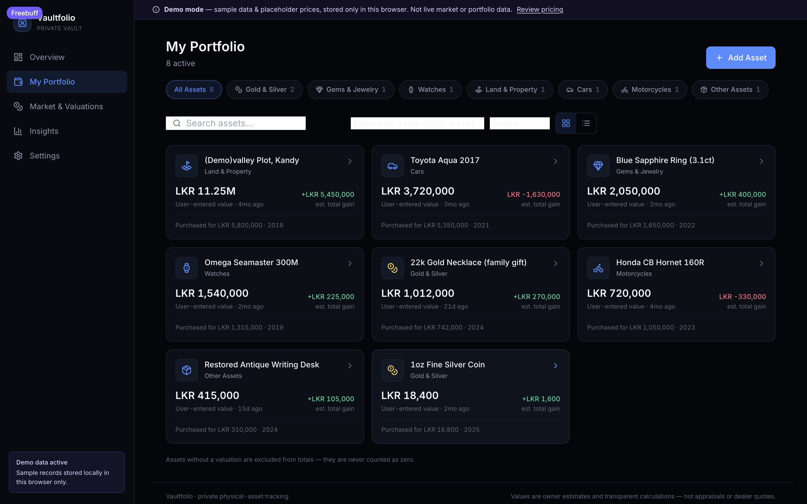
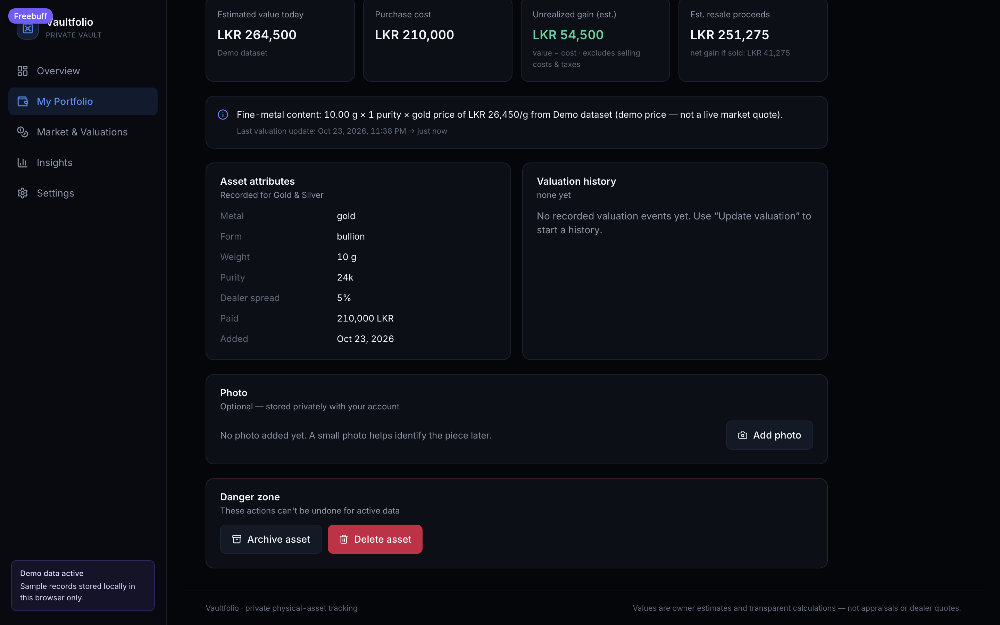
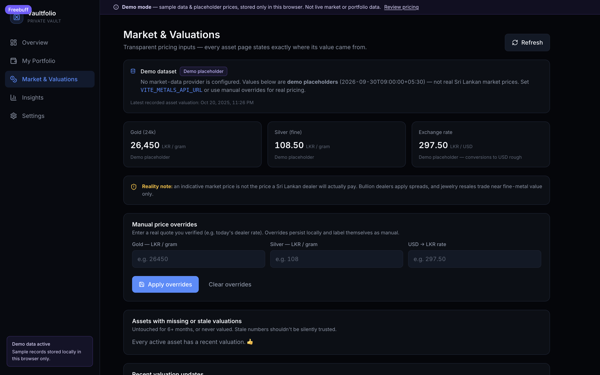
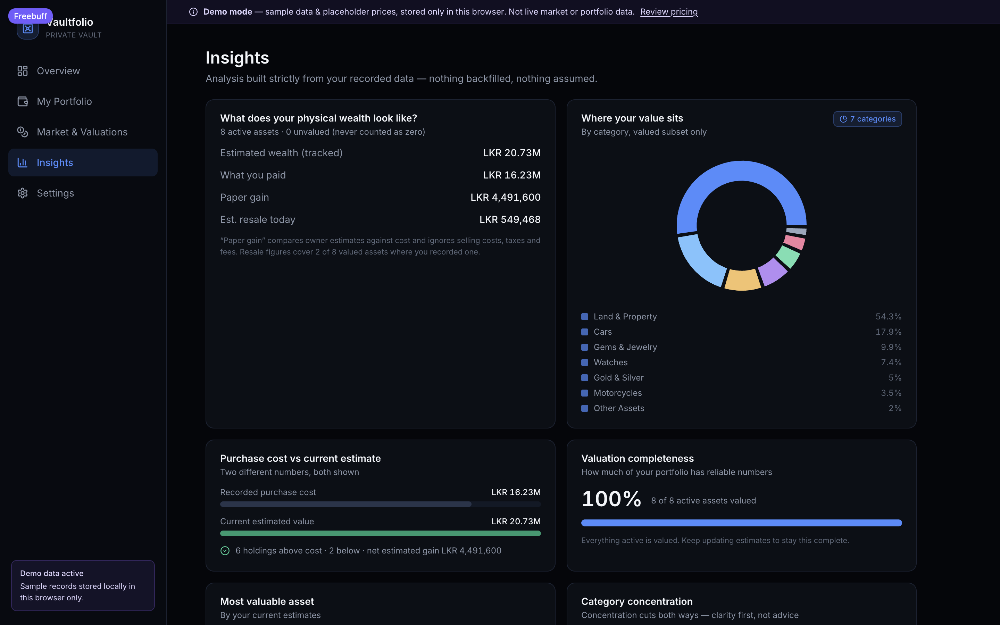

# Vaultfolio

> A private, offline-first desktop application for recording, valuing, and understanding tangible wealth with embedded machine learning intelligence.

[](LICENSE)
[](https://tauri.app)
[](https://react.dev)
[](https://www.typescriptlang.org)
[](SECURITY.md)

---

## Overview

**Vaultfolio** is an institutional-grade, privacy-first desktop platform engineered for tracking and valuing physical wealth—precious metals, investment watches, certified jewelry and gemstones, real estate, fine vehicles, and rare collectibles.

Unlike conventional cloud fintech apps that expose your asset holdings to external servers, Vaultfolio operates entirely **offline-first**. All portfolio records, valuation histories, documents, and credentials remain encrypted on your device under **AES-256-GCM** derived with **scrypt**.

The application features a built-in on-device machine learning engine powered by an embedded private CPython 3.12 runtime and scikit-learn, providing private classification, regression, and clustering analytics without network requests.

Following the **Unslop** design methodology, Vaultfolio delivers a focused desktop experience: deep near-black surfaces (`#08090B`), dark charcoal panels with subtle purple undertones, soft white typography, elegant lavender accents (`#A99BFF`), consistent Lucide iconography, and smooth micro-interactions.

---

## Download Vaultfolio

Get the official, verified desktop release for your operating system:

### macOS — Apple Silicon
[Download Vaultfolio for macOS (Apple Silicon)](https://github.com/PyDeV1OpEr/Vaultfolio/releases/latest/download/Vaultfolio-macOS-Apple-Silicon.dmg)
*Compatible with Apple Silicon Macs (M1, M2, M3, M4 series). Includes bundled ML runtime and drag-and-drop installation.*

### Windows
[Download Vaultfolio for Windows](https://github.com/PyDeV1OpEr/Vaultfolio/releases/latest/download/Vaultfolio-Windows-Setup.exe)
*Compatible with 64-bit Windows 10 and Windows 11. Self-contained NSIS installer.*

---

## Key Features

- **Private Encrypted Vault**: Zero-knowledge local vault encrypted with AES-256-GCM and scrypt key derivation. Protected by a numeric PIN or master passphrase with rate limiting and automated session timeout.
- **Master UI Transformation**: Designed using the Unslop design methodology with deep charcoal surfaces (`#08090B`, `#101116`), high-contrast soft-white typography, restrained lavender accents (`#A99BFF`), unified 18px border radii, eye-friendly contrast, and Lucide icons across every action.
- **Dynamic Metal Mark-to-Market**: Bullion and coinage holdings (Gold bars, Silver ingots, Platinum coins) automatically compute their fine weight and revalue dynamically against live spot market rates with background updates.
- **Valuation Centre & Tracking**: Dynamic portfolio tracking with support for manual appraisals, recorded valuation histories, reassessment schedules, and automated market-based mark-to-market calculations.
- **Market Watch**: Real-time international precious metal reference quotes (Gold, Silver, Platinum, Palladium, and COMEX Copper). Operates out of the box with zero configuration via keyless fallback, with optional GoldAPI.io integration.
- **Performance Analytics**: Timeframe performance metrics (7d, 30d, 90d, 1y, All) calculated strictly from recorded valuation baselines, highlighting biggest movers and portfolio staleness without mock figures.
- **AI Insights & Market Reports**: Privacy-preserving insight engine generating structured risk assessments and portfolio summaries. Optional Gemini integration (`gemini-2.5-flash`) executes with strict schema validation; the model never invents prices or alters valuation math.
- **Encrypted Documents Centre**: Store certificates of authenticity, insurance policies, land deeds, and purchase receipts (PDF, PNG, JPEG, WebP up to 25 MB) with sandbox preview, expiry tracking, and encrypted backup portability.
- **Intelligence (Private ML Workspace)**: Train, evaluate, and deploy tabular machine learning models (classification, regression, clustering) entirely on-device using a bundled private CPython runtime. Complete with confusion matrices, residual curves, ROC curves, and batch inference.

---

## Supported Asset Categories

| Category | Typical Assets | Special Capabilities |
| :--- | :--- | :--- |
| **Precious Metals** | Gold (XAU), Silver (XAG), Platinum (XPT), Palladium (XPD), Copper (XCU) | Weight conversions (grams, troy oz, tolas, sovereign), purity calculation (24k, 22k, 18k, 999 fineness), live reference repricing |
| **Jewelry & Gemstones** | Rings, necklaces, loose diamonds, sapphires, rubies, emeralds | Carat weight, certification numbers (GIA, IGI), cut/color/clarity grading |
| **Fine Timepieces** | Luxury and vintage mechanical watches | Reference numbers, serial records, movement caliber, box & papers tracking |
| **Real Estate & Land** | Commercial, residential, agricultural land | Surface area units (sq ft, sq m, acres, Sri Lankan perches), deed records |
| **Vehicles** | Classic automobiles, motorcycles, exotic cars | VIN, mileage logs, service history linkages, condition ratings |
| **Custom & Collectibles** | Rare books, art, numismatics, fine wine | Custom metric definitions, provenance documentation |

---

## Visual Tour

### Dashboard Overview


### Portfolio Holdings & Valuation


### Asset Detail & Historical Valuations


### Market Watch & Reference Quotes


### Deep Performance Insights


---

## Technology Stack

### Frontend & UI
- **Framework**: React 18 with TypeScript 5.5
- **Styling**: Tailwind CSS with custom Unslop design tokens
- **Routing**: React Router 6
- **Charts & Data Viz**: Recharts with custom SVG gradients and tooltips
- **Icons**: Lucide React
- **Build System**: Vite 5.4

### Desktop Shell & Native Layer
- **Shell**: Tauri v2
- **Core Language**: Rust (1.78+)
- **Security**: Hardened runtime, sandboxed IPC, scoped filesystem capability permissions
- **Packaging**: macOS DMG (`hdiutil`, ad-hoc/Developer ID signed), Windows NSIS installer

### Intelligence ML Engine
- **Runtime**: Pinned standalone CPython 3.12 (astral-sh/python-build-standalone)
- **Data Science Libraries**: NumPy, Pandas, Scikit-learn, SciPy, Joblib
- **Inter-process Communication**: Non-blocking NDJSON over standard streams (stdin/stdout) managed by Rust

---

## Security & Offline-First Architecture

Vaultfolio is designed with a defense-in-depth model where **your data never leaves your computer**:

1. **Zero Telemetry**: No tracking pixels, analytics cookies, remote crash reporting, or phone-home requests.
2. **Envelope Encryption**: Vault data is encrypted using AES-256-GCM. Cryptographic keys are derived from the user PIN or passphrase using `scrypt` with secure salt parameters.
3. **Sealed Credentials**: External API keys (e.g., Gemini or GoldAPI) are sealed within the encrypted vault envelope and never written in plaintext to configuration files.
4. **Air-Gapped ML Processing**: The bundled machine learning workspace executes scripts via an internal Python binary located strictly within the application bundle resources, preventing external network calls.
5. **Portable Encrypted Backups**: Backups export as password-protected encrypted archives, ensuring secure transfer across workstations.

---

## Installation & Setup

### macOS (Apple Silicon)
1. Download `Vaultfolio-macOS-Apple-Silicon.dmg` from the [Download section](#download-vaultfolio).
2. Double-click the DMG to open it.
3. Drag the **Vaultfolio** application icon into the **Applications** folder shortcut.
4. Launch Vaultfolio from Applications or Spotlight.
   *Note: If macOS Gatekeeper displays a developer notice on first launch, Control-click the application icon, choose **Open**, and confirm.*

### Windows
1. Download `Vaultfolio-Windows-Setup.exe` from the [Download section](#download-vaultfolio).
2. Run the installer and complete the setup wizard.
3. Launch **Vaultfolio** from the Start Menu or desktop shortcut.
   *Note: If Windows SmartScreen appears, click **More info** followed by **Run anyway**.*

---

## Project Structure

```
Vaultfolio/
├── .github/workflows/       # CI/CD release and verification pipelines
├── docs/                    # Technical documentation and UI screenshots
├── ml-engine/               # Offline Python ML engine & dependencies
│   ├── service/             # NDJSON Python microservice (models, train, predict)
│   ├── samples/             # Bundled CC0 tabular datasets (gems, pricing, clustering)
│   └── runtime-lock.txt     # Pinned Python package dependencies
├── scripts/                 # Build and release automation scripts
│   ├── build-ml-runtime.sh  # Standalone CPython environment packager
│   ├── release-macos.sh     # Apple Silicon packaging and verification
│   └── sample-smoke.py      # End-to-end ML integration test suite
├── src/                     # React + TypeScript frontend
│   ├── components/          # Shared UI primitives, AppLayout, Charts, Modals
│   ├── lib/                 # Crypto (AES-GCM), database, MarketWatch, validation
│   ├── pages/               # Views: Overview, Portfolio, MarketWatch, Insights,
│   │                        # AI Insights, Documents, Settings, Intelligence
│   ├── index.css            # Unslop typography and base design rules
│   └── App.tsx              # Error boundary and primary routing
├── src-tauri/               # Rust desktop shell
│   ├── capabilities/        # Tauri v2 security policies and IPC filters
│   ├── src/                 # Rust commands, ML engine process supervisor, SQLite/store
│   ├── tauri.conf.json      # Tauri application definition
│   └── Cargo.toml           # Rust dependencies
└── tailwind.config.js       # Unslop design tokens (graphite palette, mint accents)
```

---

## Building from Source

### Prerequisites
- **Node.js**: v20 or v22 (Node 22 LTS recommended)
- **Rust**: Stable toolchain (`rustup update stable`)
- **Python**: Python 3.12 (only required if building custom ML engines from scratch)

### Step 1: Clone and Install
```bash
git clone https://github.com/PyDeV1OpEr/Vaultfolio.git
cd Vaultfolio
npm ci
```

### Step 2: Quality Gate Validation
```bash
# Verify TypeScript types
npm run typecheck

# Run Vitest test suites (182 unit & integration tests)
npm test

# Build production bundle
npm run build
```

### Step 3: Run in Development Mode
```bash
# Run web client only
npm run dev

# Run desktop application with hot reload
npm run desktop:dev
```

### Step 4: Build Desktop Installers
```bash
# Package macOS DMG (Apple Silicon)
bash scripts/release-macos.sh aarch64

# Package Windows NSIS Setup (on Windows host)
npm run desktop:build:windows
```

---

## Verification & Checksums

You can verify the authenticity of release artifacts using SHA-256 hashes:

```bash
# macOS
shasum -a 256 Vaultfolio-macOS-Apple-Silicon.dmg

# Windows (PowerShell)
Get-FileHash -Algorithm SHA256 Vaultfolio-Windows-Setup.exe
```

Current release verified checksums:
- **macOS Apple Silicon**: `16faf88ac1f80a13512518805d544bc0234481f70f5081eb812927aa7d7e30d1`
- **Windows Setup**: `0fac6c3feb2a9b8b64230e5e79eebc7d2fe6fc61f64e6c57610715d96968d8d0`

---

## Troubleshooting

- **Market Watch Data**: Real-time quotes fetch automatically from the keyless `gold-api.com` fallback. A custom `VITE_GOLDAPI_KEY` is completely optional.
- **PIN Unlock Issues**: In the event of a forgotten PIN, use the master vault recovery password established during initialization.
- **Offline ML Training Duration**: Model training on large custom datasets (10,000+ rows) runs on CPU using scikit-learn. The interface shows progress indicators; training times depend on local CPU core performance.
- **Documents Preview**: Embedded previews for PDF and image attachments render within an isolated sandboxed iframe. Ensure files are under the 25 MB threshold.

---

## Attribution & License

- **Design Methodology**: Inspired by the clean, restrained principles of [Unslop](https://github.com/heydamir/unslop.git).
- **Icons**: [Lucide Icons](https://lucide.dev) (ISC License).
- **License**: Released under the [MIT License](LICENSE).
