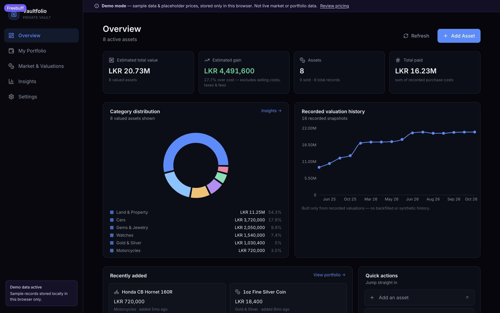
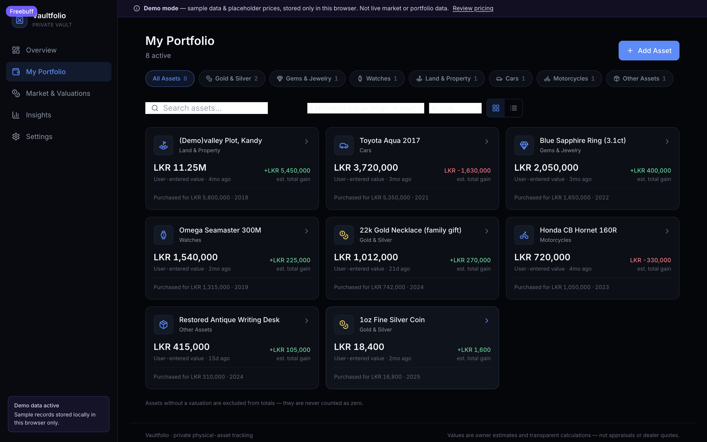
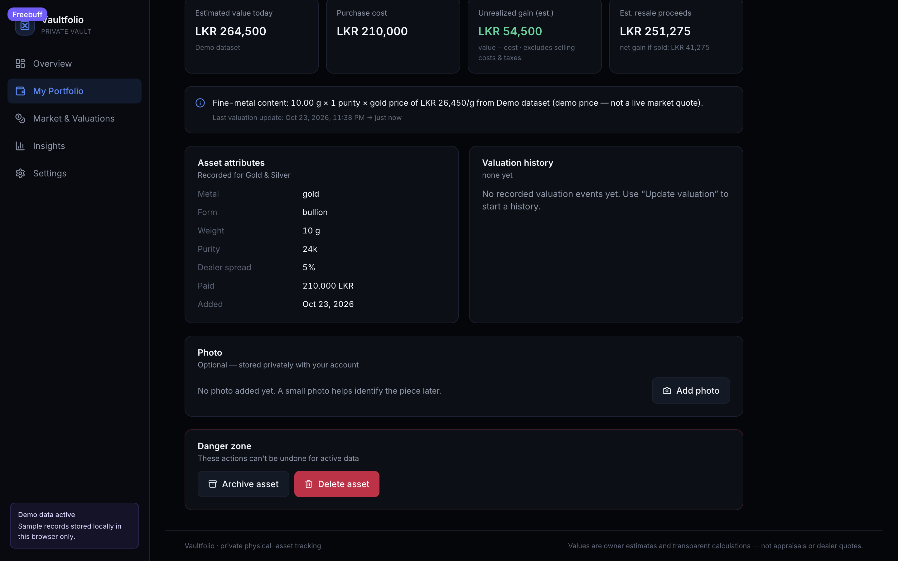
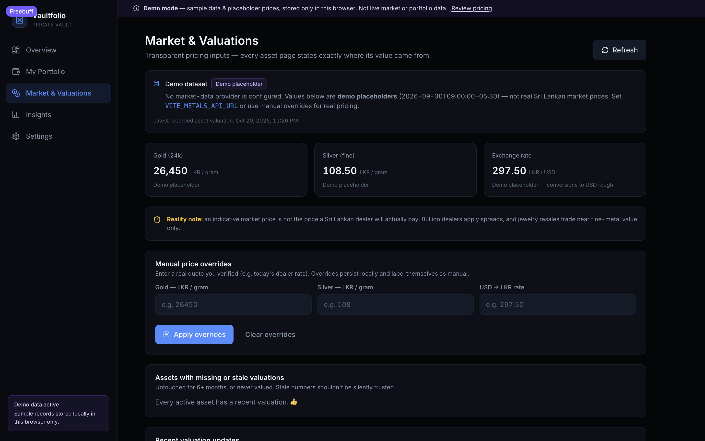
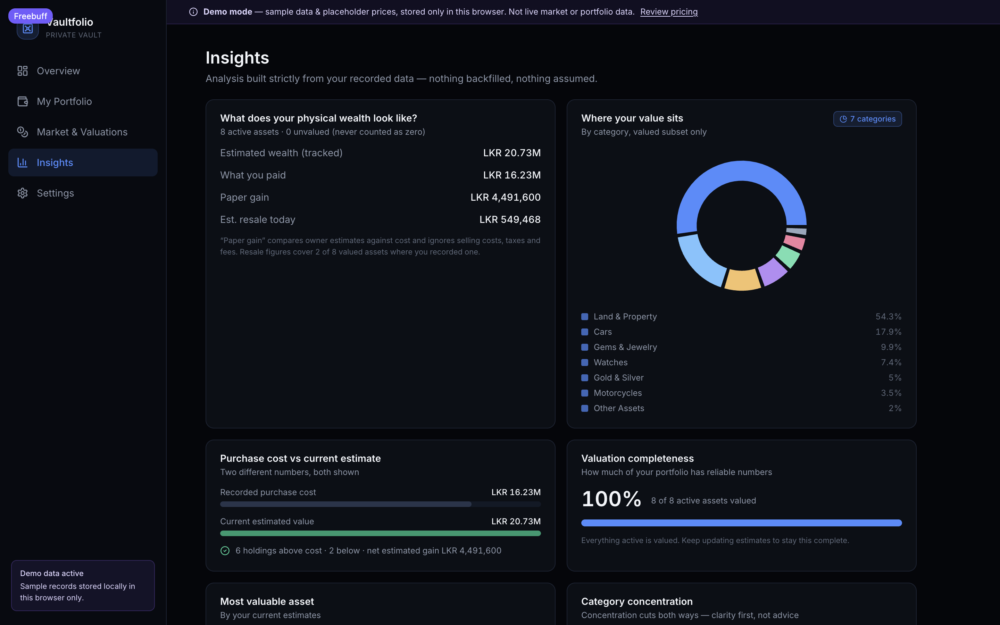
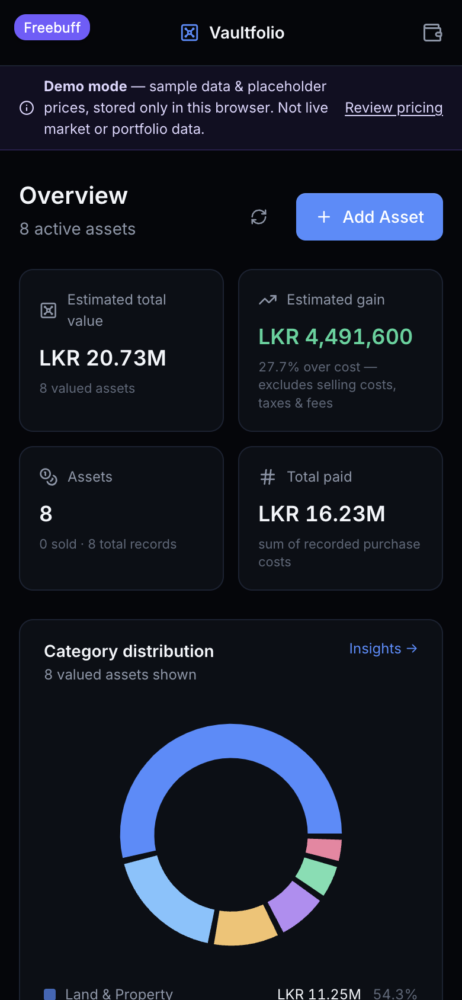
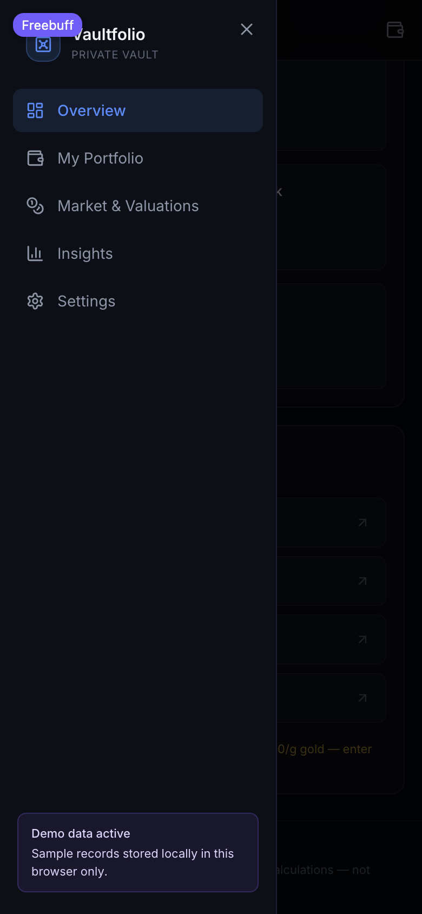

# Vaultfolio

**A private, physical-asset wealth tracker — record, value, and understand what you actually own.**

Vaultfolio is a personal wealth-tracking web app (wrapped into native desktop apps with Tauri) for people who hold physical assets instead of — or alongside — financial instruments. It tracks **gold & silver (bullion, coins, jewelry), gems & jewelry, watches, land & property, cars, motorcycles, and other assets**, organises each asset's physical facts, records honest valuations with an explicit methodology and confidence level, and rolls everything up into a portfolio overview with allocation and historical trends.

> Values are your own estimates plus transparent calculations — **not appraisals, dealer quotes, or financial advice.**

```sh
# quickstart (web, local)
git clone https://github.com/PyDeV1OpEr/Vaultfolio.git
cd Vaultfolio
npm ci
npm run dev            # → http://localhost:5173 — demo mode, sample data
```

<p align="center">
  
</p>
*Overview dashboard in demo mode: valuation breakdown, top gainers, and a compact view of all relevant categories.*

## 🖥 Download Vaultfolio

Vaultfolio runs unchanged in any modern browser — the desktop apps are simply a native wrapper around the same build:

| Platform | Package | Arch | Download |
|---|---|---|---|
| macOS | `.dmg` | Apple Silicon | [Releases → latest](https://github.com/PyDeV1OpEr/Vaultfolio/releases/latest) |
| macOS | `.dmg` | Intel | [Releases → latest](https://github.com/PyDeV1OpEr/Vaultfolio/releases/latest) |
| Windows | `.exe` setup installer | x64 | [Releases → latest](https://github.com/PyDeV1OpEr/Vaultfolio/releases/latest) |

Installing from a `.dmg`: open the file and drag **Vaultfolio.app** into `Applications`. Installing from the `.exe`: download, run the setup, and follow the NSIS wizard.

> **First public installers are not yet published.** The release workflow (`.github/workflows/release.yml`) is in place and the macOS builds have been verified locally; once a `v*` tag is pushed, the artifacts land at the URLs above and this table will be updated with exact filenames. Until then, running from source (setup below) is the supported way to use Vaultfolio.

### Unsigned-build security warnings

Release installers are currently **unsigned** (no Apple notarization / Windows Authenticode certificate is configured). That is expected for an initial open-source release:

* **macOS**: on first launch, right-click the app and choose **Open** → **Open** to confirm. `xattr -cr /Applications/Vaultfolio.app` also clears Gatekeeper for a specific copy. This is local-only and does not change system security settings.
* **Windows**: Microsoft Defender SmartScreen will show "Windows protected your PC" — click **More info** → **Run anyway**. SmartScreen still works normally for other apps.

## ✨ Features

| Area | Feature | Status |
|---|---|---|
| Assets | Create, edit, archive, and delete assets across 7 categories | ✅ Implemented |
| Assets | Category-specific attribute forms (karat/fineness, purity units, mileage, perches, etc.) | ✅ Implemented |
| Assets | Sold / restore-from-sold lifecycle with sale proceeds and realized gain | ✅ Implemented |
| Valuation | Transparent fine-metal calculation (weight × purity × market price) | ✅ Implemented |
| Valuation | Explicit valuation-method ladder: `live_market → recent_market → calculated → user → indicative → unavailable` | ✅ Implemented |
| Valuation | User-entered valuations are authoritative and never auto-overwritten | ✅ Implemented |
| Valuation | Append-only valuation history (per-asset turnover log) | ✅ Implemented |
| Market data | Gold (LKR/g), silver (LKR/g), USD/LKR — demo dataset by default | ✅ Implemented |
| Market data | Optional configurable HTTP provider (`VITE_METALS_API_URL`) | ✅ Implemented (Requires Configuration) |
| Market data | Per-user manual price overrides that always win | ✅ Implemented |
| Analytics | Portfolio totals, allocation by category, gain/loss, valuation timeline | ✅ Implemented |
| Data | CSV + JSON export of your records from Settings | ✅ Implemented |
| Auth | Email/password sign-in via Supabase Auth (sessions auto-refresh) | ✅ Implemented (Requires Configuration) |
| Sync | Cloud sync of assets + valuation records | ✅ Implemented (Requires Configuration) |
| Persistence | Demo mode stores data locally in the browser; cloud mode uses Supabase Postgres | ✅ Implemented |
| Desktop | Tauri v2 packaging for macOS (arm64 + Intel) and Windows x64 | ✅ Implemented |
| Desktop signing | Apple notarization / Windows Authenticode | 🔜 Planned (needs certs) |
| Images | Asset photos to Supabase Storage | 🔜 Planned |

## 🧱 Tech stack

| Purpose | Technology |
|---|---|
| Frontend | [React 18](https://react.dev) + [TypeScript 5](https://www.typescriptlang.org) (strict) |
| Build | [Vite 5](https://vite.dev) |
| Routing | [React Router 6](https://reactrouter.com) |
| State | [Zustand 5](https://zustand.docs.pmnd.rs) |
| Styling | [Tailwind CSS 3](https://tailwindcss.com) with a custom dark-first palette |
| Charts | [Recharts 2](https://recharts.org) |
| Icons | [lucide-react](https://lucide.dev) |
| Validation | [Zod 3](https://zod.dev) |
| Testing | [Vitest 2](https://vitest.dev) (valuation, money, units) |
| Backend / DB | [Supabase](https://supabase.com) — Auth (email/password), Postgres with Row Level Security, Storage |
| Desktop | [Tauri v2](https://v2.tauri.app) wrapping the Vite build (no Electron) |
| CI/CD | GitHub Actions — build macOS + Windows installers on `v*` tags |

## 📸 More screenshots

| | |
|---|---|
|  |  |
| *My Portfolio — allocation and per-asset rows* | *Asset detail — provenance, valuation method ladder, resale view* |
|  |  |
| *Market & Valuations — prices, overrides, staleness labels* | *Insights — timeline and trends* |
|  |  |
| *Mobile overview* | *Mobile navigation drawer* |

## 🚀 Getting started

### Prerequisites

* **Node.js 18+** (tested on Node 20) and **npm** — the only package manager used; `package-lock.json` is committed.
* No database, no API keys, no account needed to run Vaultfolio in demo mode.
* To enable cloud sync: a free [Supabase](https://supabase.com) project (setup below).
* To build/installers/stream desktop packages: [Rust](https://www.rust-lang.org) and platform prerequisites — see [DESKTOP.md](DESKTOP.md).

### Setup

```bash
git clone https://github.com/PyDeV1OpEr/Vaultfolio.git
cd Vaultfolio
npm ci
# optional: configure one env var for cloud sync (otherwise leave as-is)
cp .env.example .env
npm run dev
```

You're done when the app opens at **http://localhost:5173** — Vaultfolio starts in **demo mode** with a sample portfolio, clearly labelled with a banner. Demo data lives only in your browser (`localStorage`) and never leaves it.

### Useful scripts

| Command | Purpose |
|---|---|
| `npm run dev` | Vite dev server at http://localhost:5173 |
| `npm run build` | Production build (strict `tsc` typecheck + Vite bundle → `dist/`) |
| `npm run test` | Run the unit test suite (Vitest) |
| `npm run typecheck` | Typecheck with strict TS |
| `npm run desktop:dev` | Run inside the native Tauri window (auto-reload) |
| `npm run desktop:build:macos` | Build the macOS `.app` + `.dmg` (Apple Silicon + Intel both verified) |
| `npm run desktop:build:windows` | Build the Windows NSIS `.exe` (verified path: CI; local requires a Windows machine or CI, not macOS) |

### Cloud sync (optional)

1. Create a project on [supabase.com](https://supabase.com) and keep it to a single region.
2. Enable **Auth → email/password** and allow sign-ups.
3. Run `supabase/schema.sql` (in this repo) in the SQL editor — creates the 4 `vaultfolio_*` tables with Row-Level Security.
4. Create a **public** storage bucket named **`asset-files`** in Storage.
5. Copy **Settings → API** URL and anon key into a `.env`:

    ```sh
    VITE_SUPABASE_URL=https://<project>.supabase.co
    VITE_SUPABASE_ANON_KEY=<anon-key>
    ```

6. Restart `npm run dev` — the demo banner disappears and the **Sign in** page appears; create an account with email + password and everything else works identically.

The **anon key is public by design** — it appears inside the bundled app and it's safe. Row-Level Security on the database is the real perimeter, confining each account to its own rows.

### Market-data provider (optional)

Without `VITE_METALS_API_URL` the chart reverts to an clearly labelled demo dataset. To wire up live prices, expose an endpoint (e.g. a serverless function) returning:

```json
{ "goldPerGramLkr": 32000, "silverPerGramLkr": 42, "usdLkr": 300, "asOf": "2026-03-01T09:00:00Z" }
```

and set `VITE_METALS_API_URL` (+ optional `VITE_METALS_API_LABEL` for the display name). Never embed a provider API key in the URL — it travels to every client. The project ships intentionally without a secrets backend; a future iteration adds a serverless price proxy.

## 🗂 Codebase structure

```
src/
├── lib/            # domain logic — no React, fully unit-testable
│   ├── types.ts        # domain model (Asset, ValuationMethod, category attrs)
│   ├── valuation.ts    # transparent valuation engine + portfolio math
│   ├── units.ts        # weight/purity/currency unit conversions
│   ├── money.ts        # LKR/USD formatting, currency facts
│   ├── market.ts       # market-data service: demo + HTTP provider, cache, overrides
│   ├── demo.ts         # sample portfolio & seed data
│   ├── storage.ts      # storage adapters (LocalStorage adapter + Supabase adapter)
│   └── supabase.ts     # optional Supabase client (mode-less, lazy)
├── store/
│   └── dataStore.ts    # Zustand store: mode detection, CRUD, overrides, toasts
├── components/       # presentational + layout components, shared UI
├── pages/            # route screens (Overview, Portfolio, Market, Insights, Settings)
├── App.tsx           # router + providers
└── main.tsx          # entry
supabase/
└── schema.sql        # live schema (tables + RLS), extracted from the real project
docs/
├── ARCHITECTURE.md   # system + data flow, security, choices
└── screenshots/      # genuine screenshots of the running app
.github/
└── workflows/
    └── release.yml   # tag-triggered macOS + Windows installer builds
src-tauri/           # Tauri v2 shell (config, icons, Rust entrypoint)
```

**Where to look to change things:** adding an asset category → `src/lib/types.ts` + `AddAsset` + `dataStore`; changing valuation math → `src/lib/valuation.ts` (pure functions, tested); changing market data → `src/lib/market.ts`; persisting new fields → `src/lib/storage.ts` + `supabase/schema.sql`; new screens → `src/pages` + router in `App.tsx`; desktop builds → `src-tauri`.

## 📈 Frequently asked questions

**Is Vaultfolio free?** Yes, and the code is open source (MIT).

**Does the app run offline?** Demo mode keeps working offline because it only needs the browser; the Tauri app bundles the whole runtime. Cloud sync obviously needs a connection. Live prices need a connection as well.

**Where is my data?** Demo: your browser's local storage. Cloud: your own Supabase project under Supabase's policies, scoped per account by RLS. Vaultfolio ships no analytics, no cookies, no third-party trackers.

**Is my financial data private?** Vaultfolio doesn't see it: there is no Vaultfolio server; the app talks directly to Supabase (auth URL + anon key are compiled into the client). Demo-mode data never leaves the device.

**Can I use it as a day-trader tool?** No — Vaultfolio is explicitly a wealth-organising and valuation-honesty tool for long-held assets; it is not a market-timing, trading, or financial-ad vise platform.

## 🔒 Security & privacy

* **Perimeter**: Supabase Auth (email/password) + Postgres **Row Level Security** — every table policy reads `auth.uid() = user_id`, so a user can only ever touch their own rows. Extracted schema in [`supabase/schema.sql`](supabase/schema.sql).
* **Secrets**: the Supabase anon key is a *public* client-side key. There are no Vaultfolio-held secrets, no telemetry, and the `VITE_*` variables are plain client-side configuration.
* **Reporting**: see [SECURITY.md](SECURITY.md) — please don't report a suspected credential leak by opening a public issue.
* **Honest limits**: no end-to-end encryption, no pg schema encryption, no audit log — see the limitations in [docs/ARCHITECTURE.md](docs/ARCHITECTURE.md).

## 🧪 Testing & quality

```bash
npm run typecheck   # strict TypeScript, no loose any
npm run test        # 14 unit tests (valuation math, money, units)
npm run build       # production build must typecheck first (tsc && vite build)
```

CI runs typecheck, unit tests, and builds the web bundle on every PR (`.github/workflows/ci.yml`), with extra per-platform installers on `v*` tags (`.github/workflows/release.yml`). PRs must pass all checks before merge; the valuation domain is intentionally protected by pure-function unit tests.

## 🤝 Contributing

Read [CONTRIBUTING.md](CONTRIBUTING.md) — covers setup, conventions, and what a good PR looks like. In brief: TypeScript strict, `npm run typecheck && npm run test` must pass, keep components small, and don't add dependencies without a reason.

## 📄 License

[MIT](LICENSE) © 2026 Mohammed Unais
