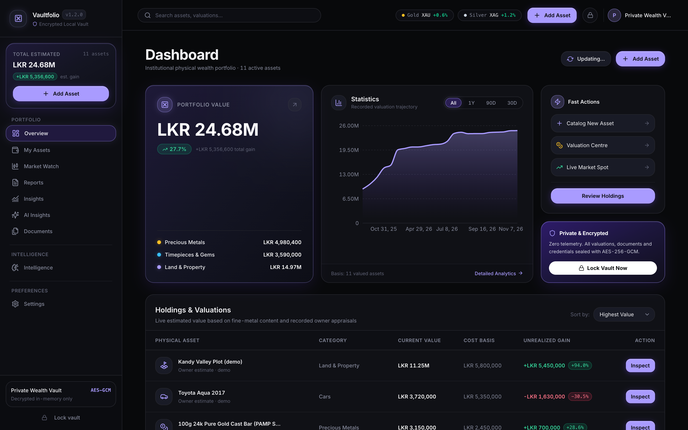
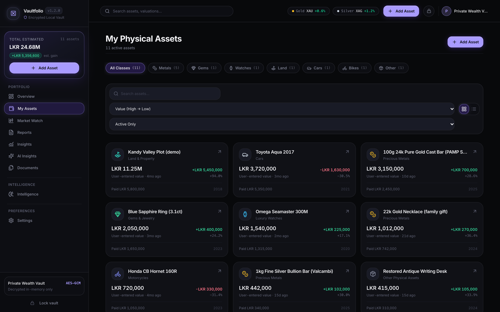
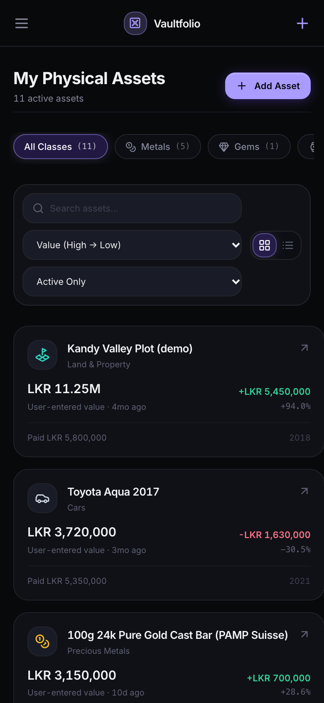

# Vaultfolio

A private, offline-first desktop application for recording, valuing, and understanding physical wealth — precious metals, gemstones, watches, land, vehicles, and other tangible assets.

[](LICENSE)
[](https://tauri.app)
[](https://react.dev)
[](https://www.typescriptlang.org)
[](https://vite.dev)
[](https://www.rust-lang.org)
[](https://github.com/PyDeV1OpEr/Vaultfolio/actions/workflows/ci.yml)

Vaultfolio is a Tauri v2 desktop app built with React, TypeScript, and Rust. It runs a local, password-protected encrypted vault, computes valuations from a transparent method ladder, tracks international metal spot prices and USD/LKR exchange rates, stores supporting documents, and includes an on-device tabular machine-learning workspace. Cloud sync and Google Gemini features are optional and require your own credentials.

---

## Contents

- [Screenshots](#screenshots)
- [Features](#features)
- [Supported assets](#supported-assets)
- [How valuation works](#how-valuation-works)
- [Market data](#market-data)
- [Security and privacy](#security-and-privacy)
- [AI features](#ai-features)
- [Intelligence ML workspace](#intelligence-ml-workspace)
- [Data and persistence](#data-and-persistence)
- [Download](#download)
- [Build from source](#build-from-source)
- [Testing and CI](#testing-and-ci)
- [Project structure](#project-structure)
- [Known limitations](#known-limitations)
- [Documentation](#documentation)
- [License and attribution](#license-and-attribution)

---

## Screenshots

| Dashboard | Portfolio |
| :---: | :---: |
|  |  |

| Asset detail | Market Watch |
| :---: | :---: |
|  |  |

| Insights | Mobile |
| :---: | :---: |
|  |   |

---

## Features

### Portfolio and asset records
- Seven asset categories with category-specific attribute forms: metal weight and purity, gem grading and certification, watch reference and serial, land extent and deed details, vehicle registration and mileage, and custom attributes.
- Cost basis, current value, unrealized gain, and net-of-dealer-spread resale metrics.
- Append-only valuation history per asset, with a full timeline in the asset detail view.
- CSV and JSON export, with serials, registrations, and addresses excluded by default.
- Responsive layout with a dedicated mobile navigation pattern.

### Valuation Centre
- Dedicated workspace for estimating, recording, and reassessing assets.
- Needs-attention classification: needs a valuation, reassessment due, information changed, or fresh.
- Configurable reassessment cadence: manual only, monthly, every 3 months, every 6 months, or annually.
- Manual valuations in LKR or USD, converted with the displayed verified FX rate.
- Optional AI-assisted appraisal for existing or new assets, with category-specific follow-up questions.
- AI results must be explicitly approved before becoming the official estimate.

### Market Watch
- International spot references for gold, silver, platinum, palladium, and copper.
- Works with zero configuration through a keyless fallback provider; GoldAPI.io can be added as an optional primary source.
- Bounded on-device observation history with 1h, 12h, 24h, 7d, 30d, and 90d windows.
- Freshness states distinguish live, recent, and stale observations.
- Low-frequency background fetching, defaulting to roughly two runs per day.
- USD/LKR conversion using a keyless exchange-rate source with a 24-hour cache.

### Insights and reports
- Performance panel for 7 days, 30 days, 90 days, 1 year, and all time, computed strictly from recorded valuations.
- Biggest movers, precious-metal market moves, and valuation-freshness panels.
- Deterministic on-device insight cards that work without any AI key.
- Optional AI market reports and AI insights when a Gemini key is configured.

### Documents
- PDF, JPEG, PNG, and WebP files up to 25 MB.
- Metadata stored inside the encrypted vault; binaries stored in a separate IndexedDB blob store.
- Sandboxed PDF preview, image zoom, rename, re-categorise, relink, download, and delete.
- Expiry tracking for insurance, warranties, and similar documents.
- Documents are included in encrypted backups; orphaned blobs are garbage-collected on launch.

### Desktop integration
- Native window shell via Tauri v2, with a strict content security policy.
- Encrypted local vault with PIN or password unlock.
- Automatic lock after 15 minutes of inactivity.
- Encrypted backup and restore.
- Tag-triggered CI builds for macOS and Windows installers.

---

## Supported assets

| Category | Examples | Category-specific fields |
| :--- | :--- | :--- |
| Gold and silver | Bars, coins, bullion, jewellery | Weight in g, kg, troy oz, or tola; karat or fineness purity |
| Gems and jewellery | Diamonds, sapphires, rubies, rings | Carat, cut, colour, clarity, certification |
| Watches | Luxury and vintage timepieces | Reference, serial, movement, condition, box and papers |
| Land and property | Residential, commercial, agricultural | Extent in perches, sq ft, or sq m; deed and location details |
| Cars | Classic, modern, exotic | Make, model, year, mileage, registration, condition |
| Motorcycles | Road, classic, collector | Make, model, year, mileage, registration, condition |
| Other | Collectibles and custom assets | User-defined attributes and notes |

---

## How valuation works

Valuation logic lives in `src/lib/valuation.ts` and `src/lib/spotValue.ts`. Every resolved value carries its method, source, confidence, and a human-readable explanation.

Resolution order:

1. An explicit user valuation, when present.
2. A market-based computation for precious metals with enough data.
3. The most recent recorded valuation.
4. `unavailable` when none of the above apply.

Precious-metal spot computation uses:

```
value_lkr = spot_per_gram_usd × grams × purity × usd_lkr
```

Unit constants are centralized in `src/lib/types.ts`:

| Unit | Conversion |
| :--- | :--- |
| Troy ounce | 31.1034768 g |
| Tola | 11.6638038 g |
| Perch to sq ft | 272.25 |
| Perch to sq m | 25.29285 |
| Pound to grams | 453.59237 |

Purity parsing accepts karats (`24k`, `22k`), decimal fractions (`.999`), named finenesses (`fine`, `sterling`, `britannia`), three-digit millesimal values, and explicit parts-per-thousand.

---

## Market data

Market Watch uses two providers:

- **GoldAPI.io** — optional primary source. Requires a user-supplied key and supports gold, silver, platinum, and palladium.
- **gold-api.com** — keyless fallback. Supports gold, silver, platinum, palladium, and copper. Copper is quoted as COMEX HG in USD per pound and mapped to XCU.

Provider observations are validated before storage; zero, negative, or impossible values are rejected. History is kept in `localStorage` with a bounded number of observations per metal and is collected forward from use, not backfilled from the provider.

Exchange rates come from `https://open.er-api.com/v6/latest/USD`. The rate is cached for 24 hours and is never presented as live when it is cached.

These are international USD reference quotes and converted LKR values. They are not Sri Lankan dealer prices, and the app labels them accordingly.

---

## Security and privacy

### Local vault

- The vault payload is encrypted with **AES-256-GCM** using `@noble/ciphers`.
- A random 256-bit data encryption key (DEK) is generated per vault.
- The DEK is wrapped by a key encryption key derived from the user's password with **scrypt** (`N = 2^15`, `r = 8`, `p = 1`) via `@noble/hashes`.
- An optional PIN can wrap the same DEK with a separate scrypt-derived key.
- Only verifiers are stored; the password and PIN themselves are never persisted.
- Domain separation is applied through additional authenticated data (AAD).
- The app locks after 15 minutes of inactivity in local mode.

### Lockout behaviour

| Control | Limit | Cooldown |
| :--- | :--- | :--- |
| PIN attempts | 5 failures | 5 minutes |
| Recovery attempts | 5 failures | 15 minutes |

### Network boundaries

- Local mode makes no telemetry, analytics, or crash-reporting requests.
- Market Watch, FX, and Gemini requests occur only when those features are used or enabled.
- Cloud mode is optional and connects to a Supabase project that you own.
- In cloud mode, the Supabase anon key is public by design; Row Level Security is the access boundary.
- The Gemini API key is stored encrypted under the vault DEK.

### Honest scope

- There is no end-to-end encryption and no independently audited security certification.
- The local vault is encrypted at rest, but the application decrypts it in memory while unlocked.
- Release installers are Developer ID signed and notarized only when the repository's Apple secrets are configured; otherwise macOS builds are ad-hoc signed and Windows builds may trigger SmartScreen.

See [SECURITY.md](SECURITY.md) for the reporting process and the current security posture.

---

## AI features

AI is optional. Without a Gemini key, the app remains fully functional, and reports show setup guidance instead of generated content.

- **Provider:** Google Gemini REST API (`generativelanguage.googleapis.com/v1beta`).
- **Default model:** `gemini-2.5-flash`; `gemini-2.5-flash-lite` and `gemini-2.5-pro` are selectable.
- **Structured output:** native `responseSchema` JSON mode plus Zod validation on arrival.
- **Pricing boundary:** the model never supplies prices, exchange rates, or balances. Numeric values are assembled app-side from the same on-device data used elsewhere.
- **Timeouts:** 60 seconds per request.
- **Evidence:** AI insights cite evidence IDs, and appraisal evidence is labelled `verified`, `model_knowledge`, or `user_supplied`.

Implemented AI surfaces:

| Feature | Source | Notes |
| :--- | :--- | :--- |
| Market reports | `src/lib/reports.ts` | Assembled from stored market observations; history in local storage |
| AI insights | `src/lib/insights.ts` | Historical context and deterministic on-device fallback |
| Valuation Centre appraisal | `src/lib/aiValuation.ts` | Range-clamped app-side; explicit approval required |

---

## Intelligence ML workspace

The Intelligence workspace is an offline-first, automated machine-learning and analytics studio tailored for tangible wealth records.

- **One-Click Automated Analysis:** No manual CSV upload required. Users can trigger complete end-to-end extraction and training directly from active vault assets with a single click.
- **Automated Dataset Extraction:** Extracts physical asset specs (purity carats, fine weight, stone carats, condition grade, age), financial metrics (acquisition cost, current valuation, gain/loss, holding days, CAGR return), and valuation method reliability while strictly isolating identifiers to prevent target leakage.
- **Automated Exploratory Data Analysis (EDA):** Calculates complete descriptive statistics (mean, std, median, IQR, skewness, Tukey's fences outlier detection), frequency distributions, and pairwise Pearson correlation matrices.
- **Data Quality Score (0–100):** Transparent scoring evaluating completeness (40%), sample adequacy (40%), and information diversity (20%) with constructive improvement guidance.
- **Candidate Model Benchmarking:** Trains and benchmarks multiple candidate estimators (Random Forest, Extra Trees, Gradient Boosting, Ridge, Lasso, and Linear/Logistic models; optional XGBoost fallback) reporting honest test-set metrics ($R^2$, RMSE, MAE, Accuracy, F1, Log Loss).
- **Interactive Parameter Simulator:** What-if parameter simulator with live predicted valuations and 90% confidence bands based on trained residuals.
- **Privacy-Preserving AI Insights:** Optional Gemini integration receives exclusively aggregated statistical summaries (never raw identifiers, asset names, or private records). Operates 100% offline via local deterministic statistical intelligence when offline or without an API key.
- **Storage & History:** Preserves historical runs under `vaultfolio.intelligence.runs.v2` for retrospective review, model comparison, and CSV export.
- **Desktop Runtime:** Bundled CPython 3.12 with NumPy, Pandas, SciPy, and scikit-learn communicating via local NDJSON IPC managed by Tauri Rust. Manual CSV import and custom datasets remain available for advanced users.

---

## Data and persistence

Vaultfolio supports two storage modes.

### Local mode (default)

- Portfolio, settings, and document metadata are stored in an encrypted vault under `vaultfolio.vault.v1` in `localStorage`.
- Legacy plaintext data under `vaultfolio.local.v1` is migrated on first use.
- Document binaries are stored in IndexedDB (`vaultfolio-docs` / `files`).
- Backups use the `vaultfolio-backup` v1 format and can be protected with `AES-256-GCM + scrypt`.
- Demo data is available in development builds and is clearly labelled.

### Cloud mode (optional)

Cloud mode connects to your own Supabase project. The repository includes `supabase/schema.sql` with:

- Tables: `vaultfolio_profiles`, `vaultfolio_assets`, `vaultfolio_valuations`, `vaultfolio_market_overrides`.
- Storage bucket: `asset-files`.
- Row Level Security policies scoped to `auth.uid()`.

Vaultfolio does not operate a hosted production instance holding user data. See [DESKTOP.md](DESKTOP.md) for packaging details and [docs/ARCHITECTURE.md](docs/ARCHITECTURE.md) for the data-flow description.

---

## Download

The latest desktop release is **v1.2.0**.

| Platform | Download |
| :--- | :--- |
| macOS — Apple Silicon | [Vaultfolio-macOS-Apple-Silicon.dmg](https://github.com/PyDeV1OpEr/Vaultfolio/releases/latest/download/Vaultfolio-macOS-Apple-Silicon.dmg) |
| Windows — x64 | [Vaultfolio-Windows-Setup.exe](https://github.com/PyDeV1OpEr/Vaultfolio/releases/latest/download/Vaultfolio-Windows-Setup.exe) |

SHA-256 checksums are published in each release's notes on the [releases page](https://github.com/PyDeV1OpEr/Vaultfolio/releases).

### First launch

- **macOS:** if Gatekeeper shows a warning, right-click the app and choose **Open**. Builds are notarized only when Apple signing secrets are configured in CI.
- **Windows:** if SmartScreen appears, choose **More info** → **Run anyway**.
- The app works fully offline. Create a local encrypted vault on first launch; no account or API key is required.

---

## Build from source

### Prerequisites

- Node.js 20 or 22 (Node 22 is used in CI)
- Stable Rust toolchain (`rustup`)
- macOS: Xcode Command Line Tools (`xcode-select --install`)
- Windows: WebView2 runtime is installed by the NSIS bootstrapper
- Python 3.12 only if you are rebuilding the bundled ML runtime

### Install and verify

```bash
git clone https://github.com/PyDeV1OpEr/Vaultfolio.git
cd Vaultfolio
npm ci

npm run typecheck
npm test
npm run build
```

### Development

```bash
# Browser-only frontend
npm run dev

# Native desktop window with hot reload
npm run desktop:dev
```

### Desktop installers

```bash
# macOS: build the bundled ML runtime, then the DMG
npm run desktop:build:macos

# Windows: run on a Windows host
npm run desktop:build:windows
```

The macOS build script targets Apple Silicon by default (`scripts/build-ml-runtime.sh --arch aarch64-apple-darwin`). Windows installers cannot be cross-compiled from macOS; use a Windows machine or the tag-triggered release workflow.

### Environment variables

All `VITE_*` variables are embedded in the client bundle at build time and must be treated as public. Copy `.env.example` to `.env.local` and fill in only what you need:

| Variable | Purpose |
| :--- | :--- |
| `VITE_SUPABASE_URL` | Supabase project URL for optional cloud mode |
| `VITE_SUPABASE_ANON_KEY` | Supabase anon key (public by design; RLS enforces access) |
| `VITE_METALS_API_URL` | Optional JSON price provider |
| `VITE_METALS_API_LABEL` | Display label for that provider |
| `VITE_GOLDAPI_KEY` | Optional GoldAPI.io primary key for Market Watch |

The keyless gold-api.com fallback requires no configuration.

---

## Testing and CI

- **Unit tests:** Vitest, across 12 test files in `src/lib/`.
- **Type checking:** `tsc --noEmit`.
- **Production build:** `tsc && vite build`.
- **CI:** `.github/workflows/ci.yml` runs typecheck, tests, and build on every push and pull request.
- **Release:** `.github/workflows/release.yml` runs on `v*` tags, builds macOS arm64/x64 DMGs and a Windows x64 NSIS installer, and publishes them to a GitHub Release.
- **Signing:** macOS Developer ID signing and notarization activate only when the five `APPLE_*` secrets are configured; otherwise the workflow uses the ad-hoc path.

ML engine tests can be run with `npm run ml-engine:test` after the runtime is built.

---

## Project structure

```
Vaultfolio/
├── .github/workflows/      # CI and tag-triggered release pipelines
├── docs/                   # Architecture notes and screenshots
├── ml-engine/              # Bundled CPython runtime, service, samples, licences
├── scripts/                # ML runtime build and release automation
├── src/
│   ├── components/         # Shared UI, layout, charts, modals
│   ├── lib/                # Crypto, valuation, market data, AI, documents, storage
│   ├── pages/              # Overview, Portfolio, Market Watch, Insights, Documents,
│   │                       # Valuation Centre, Settings, Intelligence
│   ├── store/              # Zustand data store
│   ├── App.tsx             # Routing, app modes, error boundary, auto-lock
│   └── index.css           # Base styles and design tokens
├── src-tauri/
│   ├── capabilities/       # Tauri v2 capability policy
│   ├── src/                # Rust shell, SQLite store, ML engine supervisor
│   ├── tauri.conf.json     # Window, security, and bundle configuration
│   └── Cargo.toml
├── supabase/schema.sql     # Cloud schema, RLS policies, storage bucket
├── package.json
└── tailwind.config.js
```

### Application routes

`/` dashboard · `/portfolio` · `/market-watch` · `/reports` · `/insights` · `/ai-insights` · `/documents` · `/intelligence` (datasets, train, models, predict, history, docs) · `/settings`

---

## Known limitations

- **Not financial advice.** Valuations are estimates, and market references are informational.
- **Metal prices are international references.** Converted LKR values are not local dealer quotes and exclude making charges, taxes, and spreads unless you enter them.
- **AI is optional and rate-limited by your own key.** An exhausted quota does not affect the local vault, portfolio, or Market Watch.
- **Intelligence requires the desktop build.** The browser-only development build does not include the bundled Python runtime.
- **Cloud mode is bring-your-own Supabase.** There is no Vaultfolio-hosted account service.
- **No independent security audit.** The encryption design is documented and tested but not certified.
- **Desktop signing depends on CI secrets.** Without Apple credentials, macOS builds are ad-hoc signed; without a Windows certificate, SmartScreen may warn.
- **Demo mode is for development.** It is labelled and not intended for real records.

---

## Documentation

- [docs/ARCHITECTURE.md](docs/ARCHITECTURE.md) — system, data flow, and module responsibilities
- [DESKTOP.md](DESKTOP.md) — Tauri packaging, signing, and platform notes
- [SECURITY.md](SECURITY.md) — vulnerability reporting and security posture
- [CONTRIBUTING.md](CONTRIBUTING.md) — contribution workflow
- [CHANGELOG.md](CHANGELOG.md) — release history
- [supabase/schema.sql](supabase/schema.sql) — cloud schema and RLS policies

---

## License and attribution

Released under the [MIT License](LICENSE). Copyright (c) 2026 Mohammed Unais.

- Icons: [Lucide](https://lucide.dev) (ISC License).
- Typeface: [Inter](https://rsms.me/inter/) via `@fontsource/inter` (SIL Open Font License).
- Design direction informed by the [Unslop](https://github.com/heydamir/unslop) principles.
- Bundled ML runtime licences are listed in `ml-engine/licenses/`.
