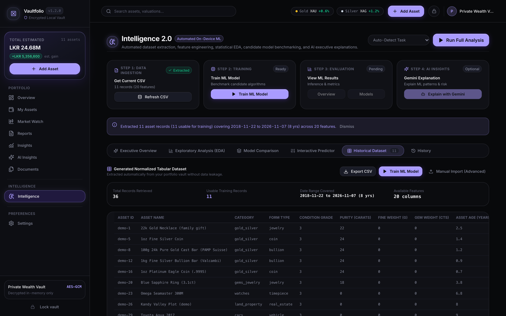
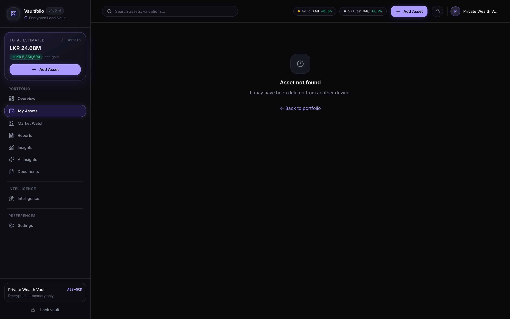
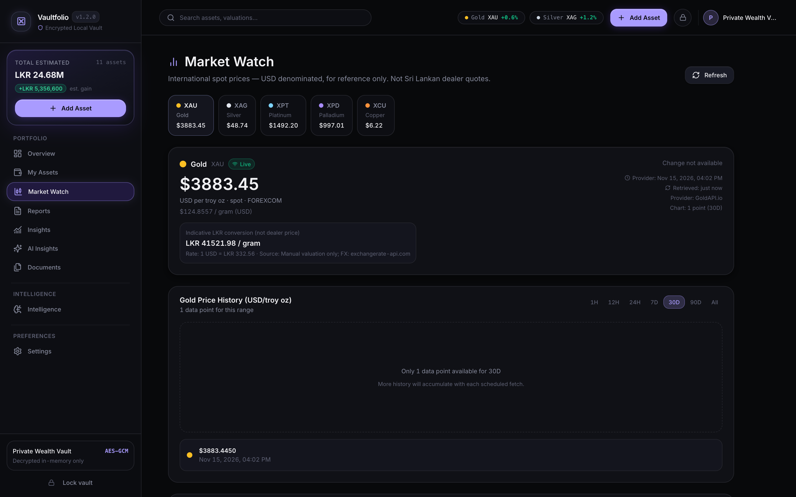
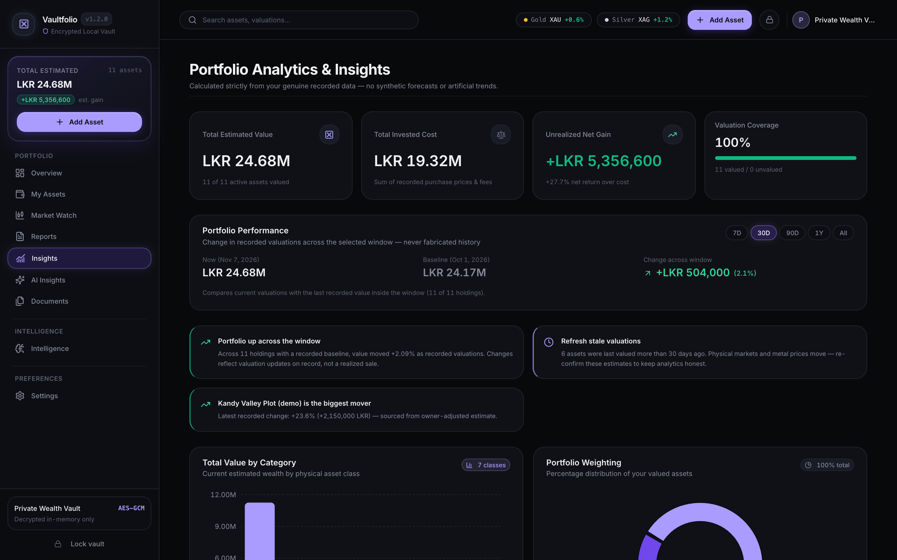
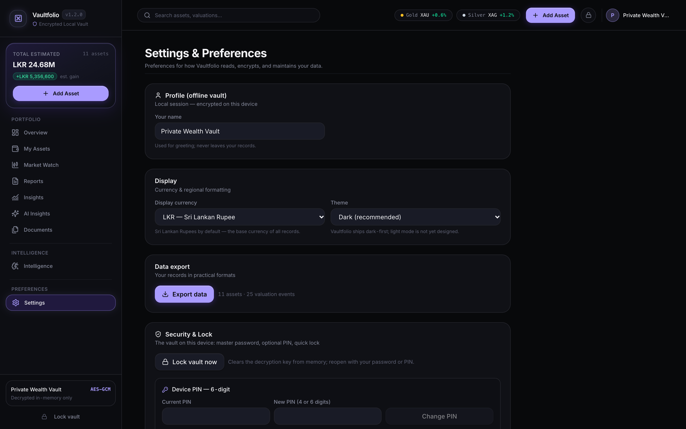
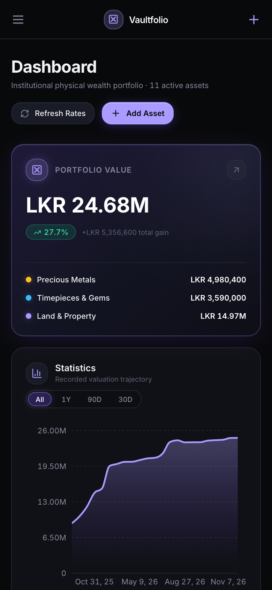
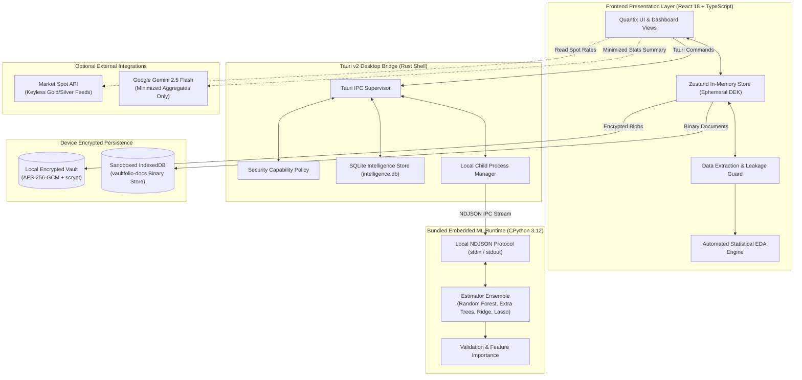
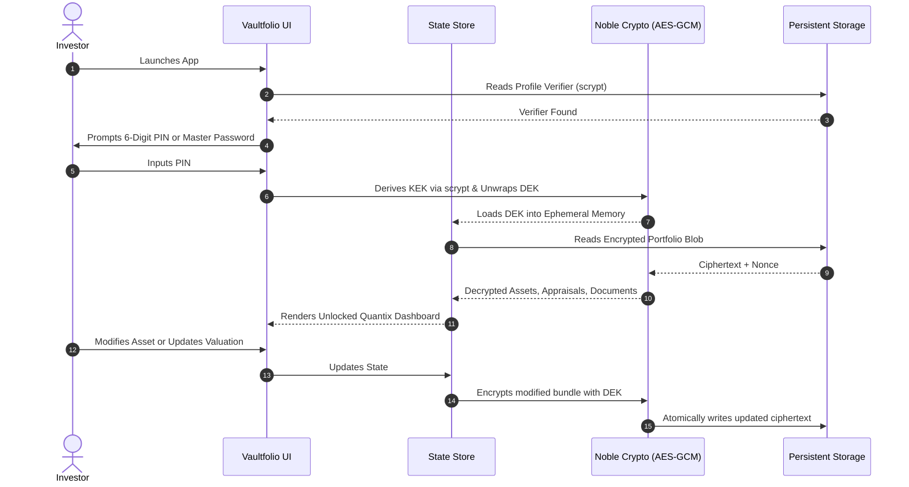
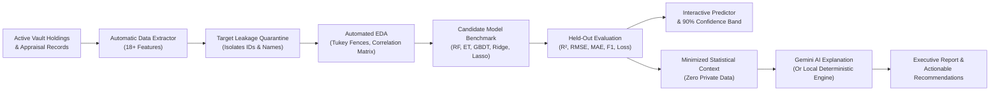

# Vaultfolio

> **Institutional-grade, offline-first desktop platform for recording, valuing, and understanding physical wealth — precious metals, investment timepieces, certified gemstones & jewellery, real estate, fine vehicles, and tangible assets.**

[](LICENSE)
[](https://tauri.app)
[](https://react.dev)
[](https://www.typescriptlang.org)
[](https://www.rust-lang.org)
[](https://scikit-learn.org)
[](https://vitest.dev)
[](SECURITY.md)

---

## ⬇️ Download Vaultfolio v1.2.0

> **Latest release** — Dark Luxury UI · Dynamic Metal Valuations · Intelligence 2.0 AutoML Studio

| Platform | Installer | Size |
|---|---|---|
| 🍎 **macOS Apple Silicon** (M1 / M2 / M3 / M4) | [**Download DMG**](https://github.com/PyDeV1OpEr/Vaultfolio/releases/download/v1.2.0/Vaultfolio-macOS-Apple-Silicon.dmg) | ~192 MB |
| 🪟 **Windows x64** | [**Download EXE**](https://github.com/PyDeV1OpEr/Vaultfolio/releases/download/v1.2.0/Vaultfolio-Windows-Setup.exe) | ~4 MB |

[View all releases →](https://github.com/PyDeV1OpEr/Vaultfolio/releases)

> **Why are the download sizes different?**
> The macOS DMG (~192 MB) bundles the complete application, all runtime resources, and platform-specific native components into a fully self-contained package — no additional installation steps required on Apple Silicon. The Windows installer (~4 MB) uses a leaner packaging approach that integrates with the existing Windows runtime environment, resulting in a significantly smaller download. Both packages deliver the full Vaultfolio desktop experience on their respective platforms.

---

## Table of Contents

- [Overview & Problem Statement](#overview--problem-statement)
- [Product Showcase](#product-showcase)
- [Core Features](#core-features)
  - [Physical Asset Inventory](#1-physical-asset-inventory)
  - [Method-Ladder Valuation Engine](#2-method-ladder-valuation-engine)
  - [Live Spot Pricing & Currency Conversion](#3-live-spot-pricing--currency-conversion)
  - [Intelligence 2.0: Automated On-Device ML](#4-intelligence-20-automated-on-device-machine-learning)
  - [Privacy-Preserving Gemini AI Synthesis](#5-privacy-preserving-gemini-ai-synthesis)
  - [Offline Encrypted Vault Security](#6-offline-encrypted-vault-security)
  - [Sandboxed Document Vault](#7-sandboxed-document-vault)
- [Technology Stack](#technology-stack)
- [System Architecture](#system-architecture)
- [Data Flow](#data-flow)
  - [Application Runtime Flow](#application-runtime-flow)
  - [Intelligence 2.0 AutoML Pipeline](#intelligence-20-automl-pipeline)
- [Database & Storage Architecture](#database--storage-architecture)
- [Machine Learning Architecture](#machine-learning-architecture)
- [Installation & Local Setup](#installation--local-setup)
- [Configuration & Environment](#configuration--environment)
- [Verification & Quality Assurance](#verification--quality-assurance)
- [Project Directory Structure](#project-directory-structure)
- [Security Model & Responsible Disclosure](#security-model--responsible-disclosure)
- [License & Attributions](#license--attributions)

---

## Overview & Problem Statement

High-net-worth individuals and collectors holding tangible physical wealth face a persistent challenge: **fragmentation and privacy exposure**.

Conventional wealth platforms rely on cloud databases that mandate transmitting sensitive personal records (physical location of bullion, safe deposit inventories, rare watch serial numbers, and property deeds) across third-party servers. Conversely, manual spreadsheets lack dynamic market valuation feeds, fail to account for fineness karats or precious stone grading, and offer zero analytical forecasting capabilities.

**Vaultfolio solves this by delivering an institutional-grade, air-gapped desktop platform**:
- **Offline-First Security**: Every portfolio record, document binary, appraisal log, and credential stays strictly on-device, encrypted under **AES-256-GCM** with a **scrypt**-derived key derivation ladder.
- **Dynamic Valuation Ladder**: Multi-method asset valuation seamlessly recomputes current holdings against international spot metal feeds (24k/22k/18k gold, 999 fine silver) and currency exchange benchmarks (USD/LKR).
- **Intelligence 2.0 AutoML Studio**: A complete, on-device machine-learning and statistical exploratory engine powered by an embedded private CPython 3.12 runtime and scikit-learn.
- **One-Click End-to-End Analytics**: Automatically extracts historical application records without manual CSV exporting, validates features, computes descriptive statistics and Tukey IQR outlier fences, benchmarks candidate estimators, and presents privacy-preserving executive insights.
- **Quantix-Inspired Dark Luxury Aesthetic**: Designed with deep near-black surfaces (`#08090B`), subtle charcoal cards (`#101116`), crisp soft-white typography, and elegant lavender accents (`#A99BFF`).

---

## Product Showcase

| Executive Dashboard | Portfolio Inventory |
| :---: | :---: |
|  |  |
| *Consolidated tangible wealth overview, asset class allocation, and real-time appreciation tracking.* | *Multi-category asset inventory with physical specifications, condition grades, and cost bases.* |

| Intelligence 2.0 AutoML Studio | Asset Detail & Valuation History |
| :---: | :---: |
|  |  |
| *Automated CSV extraction, candidate algorithm benchmarking (Random Forest, Extra Trees, Ridge, Lasso), and AI insights.* | *Chronological valuation history, holding gain analysis, and verified supporting documents.* |

| Market Watch & Metal Spot Feeds | Portfolio Analytics & Allocation |
| :---: | :---: |
|  |  |
| *Real-time precious metal spot prices, purity karat conversions, and USD/LKR exchange monitoring.* | *Concentration risk assessment, liquidity profiling, and category exposure metrics.* |

| Settings & Security Management | Mobile Responsive Interface |
| :---: | :---: |
|  | &nbsp;&nbsp;&nbsp;&nbsp; |
| *PIN setup, master recovery password, local export controls, and optional Gemini key configuration.* | *Fully responsive layout optimized across desktop, tablet, and mobile touch displays.* |

---

## Core Features

### 1. Physical Asset Inventory
Vaultfolio provides native, specialized schemas tailored to physical asset classes:
- **Precious Metals**: Gold and silver bullion, coins, and bars with weight in grams and millesimal fineness / karatage (24k, 22k, 18k, 14k, 999, 925).
- **Luxury Timepieces**: Reference numbers, serial identifiers, movement types, case metals, production year, condition grading (1–5 scale), and provenance box/paper verification.
- **Certified Gemstones & Jewellery**: Carat weight, stone variety (sapphires, rubies, emeralds, diamonds), laboratory certificate IDs (GIA, GRS, Gubelin), and metal mounting specs.
- **Real Estate & Land**: Deeds, parcel survey numbers, cadastral extents (perches / acres), property type, and municipal zoning.
- **Automobiles & Motorcycles**: VIN, make, model, year, transmission, mileage, and historical restoration records.

### 2. Method-Ladder Valuation Engine
Valuations are computed through a transparent, deterministic hierarchy:
1. **Spot Metal Fineness**: Multiplies fine metal weight by current spot price and fineness ratio ($g \times \text{Spot} \times \frac{\text{Karat}}{24}$).
2. **Professional Appraisal**: Uses formal third-party valuation amounts with appraiser credentials and date tracking.
3. **User Manual Revaluation**: Directly recorded valuation checkpoints with confidence ratings (High / Medium / Low).
4. **Historical Acquisition Cost**: Original purchase basis adjusted for acquisition fees and taxes.

### 3. Live Spot Pricing & Currency Conversion
- Automatically synchronizes international spot prices for gold and silver via keyless endpoints with fallback redundancy.
- Tracks Central Bank reference USD/LKR exchange rates for localized net worth computation.
- Allows user-defined spot price overrides for localized market premiums.

### 4. Intelligence 2.0: Automated On-Device Machine Learning
Eliminates manual CSV workflows through an integrated 4-step pipeline:
- **Step 1 — Get Current CSV**: Automatically reads active holdings and chronological appraisal observations from the persistent vault. Extracts 18+ engineered physical and financial features (purity, weight, stone carats, condition, holding duration, CAGR return) with strict target-leakage quarantine. Displays record counts, usable training samples, date ranges, and data-quality warnings.
- **Step 2 — Train ML Model**: Evaluates and benchmarks multiple candidate estimators (Random Forest, Extra Trees, Gradient Boosting, Ridge, Lasso, and Linear/Logistic models) on held-out test splits without network requests.
- **Step 3 — View ML Results**: Displays honest evaluation metrics ($R^2$, RMSE, MAE, Accuracy, F1 score), relative feature importance distributions, and interactive what-if parameter simulations with 90% confidence bands.
- **Step 4 — Gemini Explanation**: Synthesizes qualitative executive explanations of the empirical findings. Operates 100% offline via a deterministic statistical engine when no API key is set or when network is unavailable.

### 5. Privacy-Preserving Gemini AI Synthesis
- **Zero Raw Data Exposure**: Only anonymized, aggregated statistical summaries (record count, top feature weights, model validation scores, correlation coefficients) are sent to the Google Gemini API.
- Personal names, asset titles, serial numbers, notes, and raw vault records **never leave the device**.
- Output is validated against a strict Zod schema enforcing structured sections (Executive Summary, Key Findings, Model Performance, Chart Interpretation, Risks, Practical Recommendations, Limitations).

### 6. Offline Encrypted Vault Security
- Entire portfolio, transaction history, and credentials are encrypted under **AES-256-GCM**.
- Data-Encryption Key (DEK) is generated on-device with cryptographic entropy and wrapped using keys derived with **scrypt** ($N=32768, r=8, p=1$).
- Six-digit quick PIN unlock utilizes a separately wrapped DEK slot, allowing PIN changes without re-encrypting the underlying database.
- Air-gapped operational capability: zero network requests required to initialize, record, value, or train models.

### 7. Sandboxed Document Vault
- Encrypted binary storage for certificates of authenticity, purchase receipts, appraisals, and insurance policies.
- Stored locally in IndexedDB (`vaultfolio-docs`) with MIME-type verification, SHA-256 integrity hashing, and sandboxed preview rendering.

---

## Technology Stack

| Layer | Technology | Version | Technical Purpose |
| :--- | :--- | :--- | :--- |
| **Desktop Shell** | [Tauri](https://tauri.app/) | v2.0 | Native lightweight window supervisor, IPC bridge, and security capability boundaries |
| **Core Systems** | [Rust](https://www.rust-lang.org/) | 1.80+ | Secure IPC command dispatch, dataset file staging, and native child process management |
| **Frontend Framework** | [React](https://react.dev/) | 18.3.1 | Component-driven reactive UI architecture with strict error boundaries |
| **Language** | [TypeScript](https://www.typescriptlang.org/) | 5.6.3 | Strict end-to-end type safety, validation schemas, and zero `any` policy |
| **Build & Tooling** | [Vite](https://vite.dev/) | 5.4.10 | Instant Hot Module Replacement (HMR) and optimized Rollup production bundling |
| **Styling & Design** | [Tailwind CSS](https://tailwindcss.com/) | 3.4.14 | Design-token implementation of Quantix dark luxury palette and responsive grids |
| **Icons & Typography** | [Lucide React](https://lucide.dev/) / Inter | 0.454.0 | Consistent vector stroke iconography and locally bundled offline typography |
| **Visualization** | [Recharts](https://recharts.org/) | 2.13.0 | Hardware-accelerated SVG area charts, bar distributions, and scatter correlation plots |
| **ML Engine** | CPython / [scikit-learn](https://scikit-learn.org/) | 3.12 / 1.5+ | Bundled on-device runtime executing Random Forest, Extra Trees, Ridge, Lasso, and KMeans |
| **Cryptography** | [@noble/ciphers](https://github.com/paulmillr/noble-ciphers) | 2.4.0 | Audited, pure-TS cryptographic primitives for AES-256-GCM, scrypt, and SHA-256 |
| **State Management** | [Zustand](https://zustand-demo.pmnd.rs/) | 5.0.1 | High-performance uncoupled store with memory-only DEK caching and auto-lock timers |
| **Validation** | [Zod](https://zod.dev/) | 3.23.8 | Runtime schema parsing for encrypted backup payloads, IPC structs, and Gemini JSON |
| **Testing** | [Vitest](https://vitest.dev/) | 2.1.4 | High-speed unit and integration test runner for business logic, crypto, and ML pipelines |

---

## System Architecture

The following diagram represents the actual runtime architecture and isolation boundaries of Vaultfolio:



---

## Data Flow

### Application Runtime Flow



### Intelligence 2.0 AutoML Pipeline



---

## Database & Storage Architecture

Vaultfolio enforces a strict, transparent dual-storage architecture to balance absolute cryptographic privacy with machine learning performance:

### 1. Portfolio & Identity Vault (`vaultfolio.vault.v1`)
- **Technology**: Encrypted client-side store persisted under `vaultfolio.vault.v1` in `localStorage`.
- **Encryption Standard**: Authenticated **AES-256-GCM** with 96-bit unique nonces.
- **Key Derivation (KDF)**: **scrypt** with parameters $N=32768, r=8, p=1$ and a unique 128-bit cryptographic salt per profile.
- **Key Hierarchy**:
  - The portfolio is encrypted under a random 256-bit **Data-Encryption Key (DEK)**.
  - The DEK is stored wrapped under a password-derived Key-Encryption Key (KEK).
  - When a 6-digit PIN is configured, the DEK is also wrapped under a separate PIN-derived KEK with independent salt.
  - Changing the PIN re-wraps the DEK without decrypting or re-encrypting the underlying portfolio database.
- **Document Binaries**: File attachments and appraisal certificates are stored in browser IndexedDB (`vaultfolio-docs`), isolated from plaintext leaks.

### 2. Machine Learning Intelligence Database (`intelligence.db`)
- **Technology**: Local embedded SQLite database utilizing Write-Ahead Logging (`WAL` mode) and strict foreign key integrity.
- **Filesystem Location**:
  - macOS: `~/Library/Application Support/com.vaultfolio.app/intelligence.db`
  - Windows: `%APPDATA%\com.vaultfolio.app\intelligence.db`
  - Linux: `~/.local/share/com.vaultfolio.app/intelligence.db`
- **Isolation Principle**: The ML SQLite database manages imported tabular training datasets, generated feature matrices, and trained model artifact metadata. It contains **no master passwords, credentials, or private wallet keys**.
- **Model Checksums**: Every trained Scikit-learn model bundle is assigned a SHA-256 cryptographic hash upon persistence, verified prior to inference execution.

---

## Machine Learning Architecture

The embedded machine-learning pipeline operates locally via the bundled private CPython runtime communicating over NDJSON:

### Implemented Algorithms
- **Regression (Valuation Estimation)**:
  - `RandomForestRegressor`: Non-linear ensemble handling complex physical feature interactions.
  - `ExtraTreesRegressor`: Extremely randomized trees reducing variance on small physical asset datasets.
  - `GradientBoostingRegressor`: Sequential error-correcting boosted trees.
  - `Ridge`: Linear regression with $L_2$ regularization preventing collinearity between weight and spot rates.
  - `Lasso`: Linear regression with $L_1$ sparsity regularization for feature selection.
- **Classification (Performance Tiering)**:
  - `RandomForestClassifier` & `ExtraTreesClassifier`: Multiclass classifiers predicting Outperforming, Steady, or Underperforming asset tiers.
  - `LogisticRegression`: Softmax cross-entropy baseline estimator.
- **Clustering (Portfolio Segmentation)**:
  - `KMeans`: Unsupervised partition into valuation and holding duration clusters with Euclidean distance tracking.
  - `DBSCAN`: Density-based spatial clustering identifying anomalous acquisition costs.

### Preprocessing & Leakage Prevention
- **Leakage Guards**: Asset identifiers (`asset_id`), display names (`asset_name`), and serial tags are marked with `isLeakageRisk: true` and excluded from model feature sets.
- **Missing Value Handling**: Median imputation for numerical features; category frequency mode imputation for sparse categoricals.
- **Tukey IQR Outlier Detection**: Statistical outlier flagging using interquartile ranges:
  $$\text{Outlier} \notin [Q_1 - 1.5 \times \text{IQR},\, Q_3 + 1.5 \times \text{IQR}]$$
- **Feature Importance Extraction**: Extracted directly from Scikit-learn estimators via normalized tree Gini importances (`feature_importances_`) or normalized linear regression coefficients (`coef_`).

### Gemini AI Explanation Layer
- Gemini acts exclusively as an analytical interpreter of the empirical ML outputs.
- It **never computes** or fabricates metrics.
- Minimized payloads contain only:
  ```json
  {
    "task": "regression",
    "target": "current_valuation_lkr",
    "rowCount": 24,
    "featureCount": 18,
    "bestModel": { "label": "Random Forest Regressor", "score": 0.942 },
    "topFeatures": [{ "feature": "fine_weight_g", "importance": 0.38 }],
    "topCorrelations": [{ "featureA": "fine_weight_g", "featureB": "current_valuation_lkr", "correlation": 0.96 }]
  }
  ```
- **Deterministic Offline Fallback**: If no Gemini key is provided, or if the user is offline, `generateLocalDeterministicReport` derives a comprehensive, rigorous executive intelligence brief directly on-device using local statistics.

---

## Installation & Local Setup

### Prerequisites
- [Node.js](https://nodejs.org/) v18.0.0 or later (v20+ recommended)
- [Rust](https://www.rust-lang.org/) stable toolchain (`cargo` and `rustc`)
- [Python](https://www.python.org/) 3.12+ (for ML runtime compilation)
- Platform build dependencies:
  - macOS: Xcode Command Line Tools (`xcode-select --install`)
  - Linux: `libwebkit2gtk-4.1-dev build-essential curl wget libssl-dev libgtk-3-dev libayatana-appindicator3-dev librsvg2-dev`
  - Windows: Visual Studio C++ Build Tools & WebView2

### 1. Clone the Repository
```bash
git clone https://github.com/PyDeV1OpEr/Vaultfolio.git
cd Vaultfolio
```

### 2. Install Frontend Dependencies
```bash
npm install
```

### 3. Run in Development Mode
To start the Vite frontend with Hot Module Replacement:
```bash
npm run dev
```

To run the complete Tauri desktop application:
```bash
npm run desktop:dev
```

### 4. Build Desktop Applications
- **macOS Apple Silicon (ARM64 DMG)**:
  ```bash
  npm run desktop:build:macos
  ```
- **Windows (x64 Setup EXE)**:
  ```bash
  npm run desktop:build:windows
  ```

---

## Configuration & Environment

Vaultfolio is completely functional out of the box with zero required environment variables. Optional features can be configured via UI in **Settings** or via `.env`:

```bash
# Optional: Google Gemini API Key for AI Insights and Executive Summaries
# Can also be set securely via the desktop application Settings screen (encrypted on-device)
VITE_GEMINI_API_KEY=""

# Optional: GoldAPI.io custom key for spot precious metals (keyless fallback is active by default)
VITE_GOLDAPI_KEY=""

# Optional: Supabase configuration (only needed for optional web cloud sync builds)
VITE_SUPABASE_URL=""
VITE_SUPABASE_ANON_KEY=""
```

---

## Verification & Quality Assurance

Vaultfolio enforces strict quality gates across TypeScript, Rust, Python, and frontend test suites.

### 1. Frontend & Logic Vitest Suite (197 Tests)
```bash
npm test
```
*Executes all 13 test suites covering AES-256-GCM crypto, scrypt KDF, method-ladder appraisal rules, Market Watch spot calculations, backup serialization, and the complete Intelligence 2.0 pipeline.*

### 2. Python ML Engine Test Suite (23 Tests)
```bash
python3 ml-engine/service/engine_tests.py
```
*Validates NDJSON roundtrips, model serialization, train/test splitting, confusion matrices, ROC-AUC, regression residuals, and clustering distance bounds.*

### 3. TypeScript Type Safety
```bash
npm run typecheck
```
*Strict `tsc --noEmit` check verifying 0 compiler errors.*

### 4. Rust Desktop Shell Verification
```bash
cargo check --manifest-path src-tauri/Cargo.toml
```

### 5. Production Production Bundle Build
```bash
npm run build
```

---

## Project Directory Structure

```text
Vaultfolio/
├── .github/workflows/          # CI pipelines (build, test, desktop release)
├── docs/
│   ├── ARCHITECTURE.md         # Deep-dive architectural specification
│   └── screenshots/            # Authentic application screenshots (Retina 2x)
├── ml-engine/                  # On-device machine-learning runtime
│   ├── licenses/               # Third-party runtime licensing notices
│   ├── samples/                # Reference CC0 tabular datasets
│   └── service/                # CPython supervisor service & scikit-learn models
├── scripts/                    # Packaging automation and runtime build scripts
├── src/                        # React 18 + TypeScript application source
│   ├── components/             # Reusable UI tokens, cards, modal dialogs, Recharts
│   │   ├── intel/              # Classification, regression, and clustering charts
│   │   └── ui.tsx              # Design tokens (Pill, Badge, Card, StatCard, Button)
│   ├── lib/                    # Core business logic and storage engines
│   │   ├── crypto.ts           # Audited AES-256-GCM, scrypt, and SHA-256 primitives
│   │   ├── intelligence/       # Intelligence 2.0 AutoML Engine
│   │   │   ├── autoMlOrchestrator.ts  # End-to-end 4-step pipeline coordinator
│   │   │   ├── dataExtractor.ts       # Vault database extractor & leakage guard
│   │   │   ├── edaEngine.ts           # Descriptive statistics, Tukey IQR, correlations
│   │   │   ├── geminiIntelligence.ts  # Privacy-preserving Gemini & offline fallback
│   │   │   ├── historyStore.ts        # Local run persistence store
│   │   │   └── intelligence.test.ts   # 15 comprehensive unit & integration tests
│   │   ├── market.ts           # Spot gold, silver, and USD/LKR exchange synchronizer
│   │   ├── profile.ts          # Local user identity and credential verifiers
│   │   ├── storage.ts          # Encrypted local storage and backup adapters
│   │   └── valuation.ts        # Dynamic physical asset valuation ladder
│   ├── pages/                  # Top-level view controllers
│   │   ├── Intelligence/       # Intelligence 2.0 Studio, Dataset Review, History
│   │   ├── Overview.tsx        # Executive net worth and allocation dashboard
│   │   ├── Portfolio.tsx       # Physical asset grid and category filters
│   │   ├── AssetDetail.tsx     # Single asset view with historical appraisal log
│   │   ├── MarketWatch.tsx     # Precious metal spot charts and currency monitor
│   │   ├── Insights.tsx        # Portfolio risk, concentration, and return analysis
│   │   └── Settings.tsx        # Security, PIN, recovery password, and API preferences
│   ├── store/                  # Zustand global application state store
│   ├── App.tsx                 # Routing, auto-lock timeout, and Error Boundary
│   └── index.css               # Quantix dark luxury design tokens and animations
├── src-tauri/                  # Tauri Rust desktop backend
│   ├── capabilities/           # Security capability policy manifests
│   ├── src/                    # Rust commands, IPC bridge, and SQLite manager
│   ├── tauri.conf.json         # Tauri v2 application configuration
│   └── Cargo.toml              # Rust dependency definitions
├── package.json                # Project dependencies and scripts
├── tailwind.config.js          # Tailwind color tokens and layout configuration
└── tsconfig.json               # TypeScript strict compiler options
```

---

## Security Model & Responsible Disclosure

Vaultfolio was engineered from inception around **zero-trust local privacy**:
1. **Never Stored in Plaintext**: Master passwords and PINs are never persisted in any form. Only cryptographically salted scrypt verifiers exist on disk.
2. **Ephemeral Memory Caching**: The Data-Encryption Key (DEK) resides solely in volatile application memory while unlocked. It is wiped upon manual lock, application termination, or after 15 minutes of user inactivity.
3. **No Centralized Telemetry**: The application transmits zero tracking beacons, telemetry, user analytics, or usage crash reports.
4. **Air-Gapped Operation**: All critical functionality (asset recording, market valuation calculation, document storage, and ML model training) executes natively without network connectivity.

*To report potential security vulnerabilities or review cryptographic design specifications, please refer to [SECURITY.md](SECURITY.md).*

---

## License & Attributions

Vaultfolio is open-source software licensed under the **[MIT License](LICENSE)**.  
Copyright © 2026 Mohammed Unais.

- **Design Philosophy**: Visual aesthetic informed by the restrained design principles of [Unslop](https://github.com/heydamir/unslop).
- **Iconography**: [Lucide React](https://lucide.dev/) (ISC License).
- **Typography**: [Inter](https://rsms.me/inter/) by Rasmus Andersson (SIL Open Font License).
- **Third-Party Libraries**: Detailed notices and runtime licenses are documented in `ml-engine/licenses/`.
