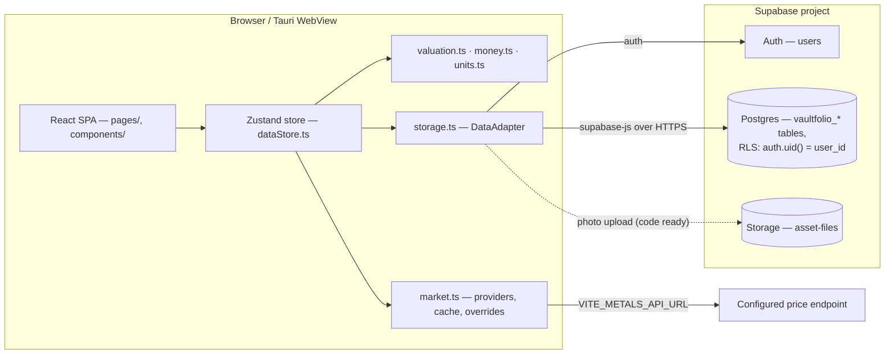
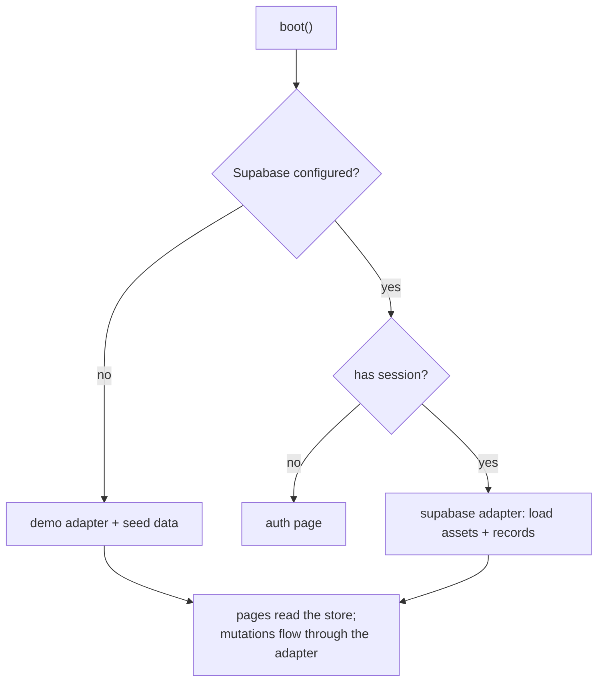

# Vaultfolio — Architecture

This document describes the system **as it is implemented**, traced through the source in `src/` and cross-checked against the deployed Supabase project (schema extracted live into [supabase/schema.sql](../supabase/schema.sql)). Nothing here is aspirational — planned or unimplemented items are marked as such.

## System overview

Vaultfolio is a single-page React application that ships in three forms:

1. **Web (browser)** — built with Vite → `dist/`, statically deployable anywhere.
2. **Desktop (macOS/Windows)** — the *same* `dist/` bundle wrapped in a [Tauri v2](https://v2.tauri.app) native window; no Electron, no bundled Node runtime.
3. **Demo mode** — the mode the app *starts in* when Supabase env vars are absent: identical UI, seeded sample data, `localStorage` persistence.

There is **no Vaultfolio server and no Vaultfolio API**. All persistence and auth go directly from the client to a Supabase project (the author's for the demo deploy, the user's own for private cloud sync):

* **Auth** — Supabase Auth, email + password.
* **Data** — Postgres tables `vaultfolio_assets`, `vaultfolio_valuations`, `vaultfolio_profiles`, `vaultfolio_market_overrides`, protected by Row Level Security.
* **Files** — asset photos to the `asset-files` storage bucket (column + adapter code exist; bucket provisioning is step 4 in the schema setup).
* **Market prices** — an env-configured generic HTTP endpoint, else a clearly-labelled demo dataset.

## High-level diagram

## Boot, mode selection, and data flow

`src/store/dataStore.ts` is the single brain; `src/lib/storage.ts` abstracts *where* user data lives behind a `DataAdapter` interface with two implementations: `LocalStorageAdapter` (demo) and `SupabaseAdapter` (cloud).

On app boot (`boot()`):

1. Restore persisted settings (currency, owner name).
2. `supabaseConfigured` decides the starting mode:
   * **No credentials** → demo adapter with seeded sample data ([demo.ts](../src/lib/demo.ts)).
   * **Credentials present** → restore any Supabase session; signed-in → load data through the cloud adapter, signed-out → show the auth page.
3. The store exposes `assets`, `records`, and `market` to every page. A mutation (add/edit/delete/mark-sold/set-override) is applied **through the adapter interface only** — pages never touch Supabase or `localStorage` directly.

## Valuation engine (the honest-numbers core)

[src/lib/valuation.ts](../src/lib/valuation.ts) — pure functions, unit-tested. `resolveAssetValuation(asset, market)` walks a strict priority ladder and **never silently substitutes**:

| Priority | Method | Meaning |
|---|---|---|
| 1 | `user` | Owner-entered value; authoritative and never auto-overwritten (the computed alternative is surfaced alongside for comparison). |
| 2 | `calculated` | Gold & silver only: `grams × purity × price/gram`. Demo-market prices yield `indicative` + low confidence instead. |
| 3 | `live_market` / `recent_market` | A recorded valuation with its original source label. |
| 4 | `unavailable` | Value is `null`; the UI never shows a fabricated number. |

Money mechanics (`assetMetrics` in valuation.ts): `purchaseCost = purchasePrice + extraCosts`; two distinct gain figures — `unrealizedGain = currentValuation − cost` and `resaleGain = estimated resale proceeds − cost`, where resale applies the explicitly recorded dealer spread for fine metal. `statsFor` tracks `valuedCount` vs `unvaluedCount` so an unvalued asset is never silently dropped from the totals.

**Valuation history is append-only** (`vaultfolio_valuations` / `ValuationRecord[]`): every edit carrying a valuation produces a new record. `portfolioTimeline` reconstructs each date's portfolio value by carrying each active asset's last-known value forward and summing only currently-active assets.

## Market data

[src/lib/market.ts](../src/lib/market.ts) is deliberately pluggable and honest:

* **Provider contract**: `MetalProvider.fetch()` returns `null` when it did *not* actually obtain data; the app never invents "live" figures.
* **Priority**: the env-configured HTTP provider (`VITE_METALS_API_URL`, optional display label `VITE_METALS_API_LABEL`) — whose response shape is `{ goldPerGramLkr, silverPerGramLkr, usdLkr, asOf }` — takes precedence over the demo provider.
* **Per-user overrides** (`gold_per_gram`, `silver_per_gram`, `usd_lkr` via `vaultfolio_market_overrides` in cloud mode, a store field in demo) **always win** over any fetched price and are labelled user-entered.
* **Cache & staleness**: fetched snapshots are cached with a 6-hour TTL; a stale snapshot is shown *with a stale label*, not silently hidden or reused as fresh.
* **Failure**: any provider or network error degrades gracefully — nothing breaks the dashboard, and the UI keeps telling the user exactly which source produced the numbers it shows.

## Database schema

The real, deployed schema is mirrored in [supabase/schema.sql](../supabase/schema.sql) and matches the row mappings in [storage.ts](../src/lib/storage.ts) exactly. Essentials:

* `vaultfolio_assets` — one row per physical asset. Category-specific physical facts (karat/fineness, perches/sqft, engine mileage, watch serials) live in **`attributes_json`** (a JSONB column), so adding asset attributes does not require schema churn. CHECK constraints guard `category`, `status`, `valuation_method`, and `valuation_confidence`.
* `vaultfolio_valuations` — append-only history. **FK**: `asset_id → vaultfolio_assets(id) ON DELETE CASCADE`, so deleting an asset also removes its valuation history (the adapter additionally deletes orphan records explicitly).
* `vaultfolio_profiles` — `display_name` only.
* `vaultfolio_market_overrides` — **UNIQUE `user_id`**, one override set per user.
* All `user_id` columns `REFERENCES auth.users(id) ON DELETE CASCADE` — deleting a Supabase auth user deletes their Vaultfolio data.

## Security boundaries & private-data handling

* **Every table has RLS enabled** with `auth.uid() = user_id` (for profiles: `auth.uid() = id`). Holding the anon key alone cannot read or write another account's rows. *Exception*: the `asset-files` storage bucket is public-read by URL when photo upload is used; bucket-level policies must be configured at setup time.
* **Public-by-design credentials**: only `VITE_SUPABASE_URL` + anon key exist client-side. The app holds no secrets, sends no telemetry, and stores no analytics cookies.
* **Deliberately-not-exported fields**: watch serial, vehicle registration, and full address fields are marked private in the add/edit UI and omitted from CSV export by default.
* **Honest limits**: no end-to-end encryption — Supabase Postgres stores row plaintext and its operators can physically read it; sessions are standard Supabase JWTs in local storage; there is no audit log.

## Configuration

| Variable | Purpose |
|---|---|
| `VITE_SUPABASE_URL` | Enables cloud mode when set; absent → demo mode. |
| `VITE_SUPABASE_ANON_KEY` | Supabase anon key (public by design). |
| `VITE_METALS_API_URL` | Optional live-price endpoint. |
| `VITE_METALS_API_LABEL` | Display name of the configured price source. |

⚠️ All `VITE_*` values are **embedded in the shipped bundle** — see [README → market provider](../README.md#market-data-provider-optional) for the response shape, and never point `VITE_METALS_API_URL` at an endpoint that carries a secret key in its URL.

## Error handling

* Store mutations wrap the adapter call in try/catch, surface the failure as a toast, and (in cloud mode) optimistically apply the local change and roll it back on failure — demo mode never leaves `localStorage` inconsistent.
* The market provider treats *no data* (`null`) as a legitimate return, not an exception path.
* A failing Supabase *load* on boot degrades to a visible error state, not a blank screen.

## Known limitations

* Light theme and full i18n: settings keys exist, only dark + English (LKR-first) shipped.
* Asset photos: DB column and storage code exist; the schema file does not provision the bucket (documented step).
* No automated backup beyond the CSV/JSON export in Settings; Supabase-side backup is the user's responsibility.
* No hosted Vaultfolio instance — cloud sync always points at *the user's own* Supabase project, so there is no central owner who could see user data at all.
